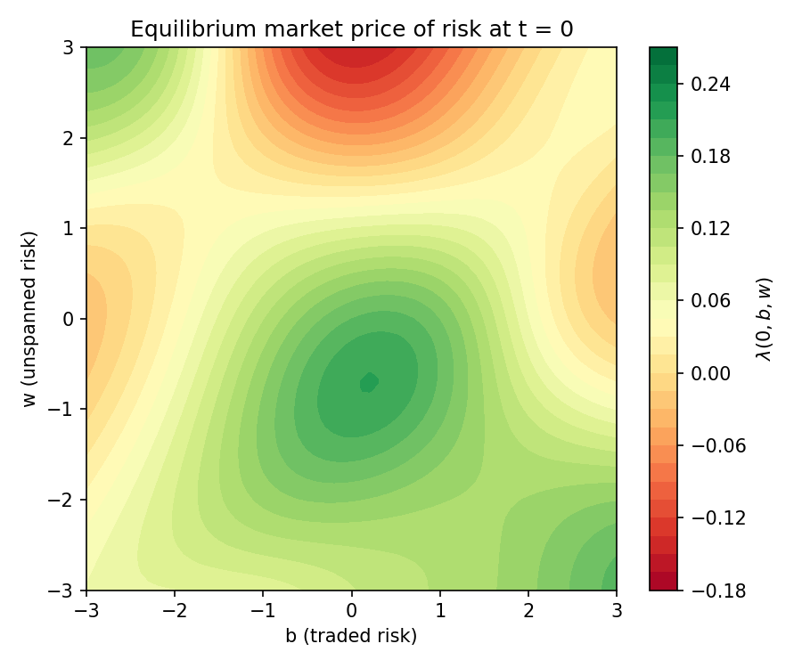
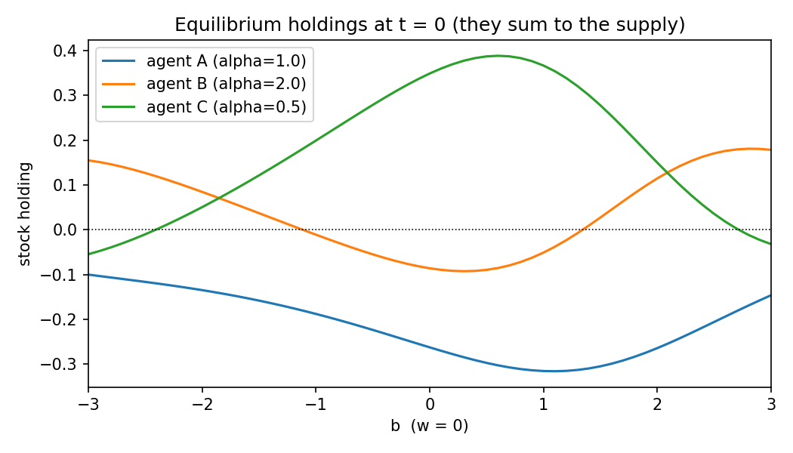

# Équilibre de marché en temps continu avec marché incomplet

Existence, caractérisation et calcul numérique d'un **équilibre de Radner** en temps continu lorsque le marché est **incomplet**. Les agents ont des préférences exponentielles (CARA) et des dotations exposées à un risque non négociable.

> **Ce que ce dépôt démontre, et ce qu'il ne démontre pas.**
> L'existence d'un équilibre en marché incomplet est un problème ouvert en toute généralité : elle revient à résoudre un système de EDSR (BSDE) quadratiques couplées, et de tels systèmes peuvent ne pas avoir de solution. Ce dépôt :
> 1. **caractérise** l'équilibre comme solution d'un système d'EDP/EDSR (Théorème 1) ;
> 2. **démontre l'existence** en forme fermée dans une classe incomplète explicite, les dotations séparables (Théorème 2) ;
> 3. **calcule numériquement** l'équilibre dans un cas non séparable, sans forme fermée, puis le **vérifie** indépendamment par Monte Carlo ;
> 4. délimite empiriquement la zone de paramètres où le calcul est fiable.
>
> Il ne fournit **pas** de preuve d'existence générale.

## 1. Le modèle

Sur $[0,T]$, deux mouvements browniens indépendants :
- $B$ est le risque **négociable**. Une action en offre nette $\theta$ suit la dynamique de Bachelier $dS_t = \lambda_t\,dt + dB_t$, et le taux sans risque est nul.
- $W$ est le risque **non couvert** : aucun actif n'y est exposé.

L'agent $i$ a une aversion absolue au risque $\alpha_i>0$ et une dotation terminale $\xi_i = g_i(B_T, W_T)$. Il choisit une position $\pi^i$ en actions pour maximiser

$$\mathbb E\big[-\exp\big(-\alpha_i\,(X_T^{\pi^i} + \xi_i)\big)\big],\qquad X_T^{\pi}=\int_0^T \pi_t\,(\lambda_t\,dt + dB_t).$$

Dès que $g_i$ dépend de $W_T$, le marché est **incomplet**.

**Définition.** Un *équilibre* est un prix du risque $\lambda$ (processus adapté) tel que les stratégies optimales $\pi^{i,*}$ **soldent le marché** : $\sum_i \pi^{i,*}_t = \theta$ pour tout $t$, p.s.

## 2. Caractérisation (Théorème 1)

Pour un $\lambda$ donné, on cherche la valeur de l'agent sous la forme $-\exp(-\alpha_i(x+Y^i_t))$. Le principe de martingale / sur-martingale impose

$$\pi^{i,*} = \frac{\lambda}{\alpha_i} - Z^i,\qquad dY^i_t = \Big(Z^i_t\lambda_t - \frac{\lambda_t^2}{2\alpha_i} + \frac{\alpha_i}{2}(\tilde Z^i_t)^2\Big)dt + Z^i_t\,dB_t + \tilde Z^i_t\,dW_t,\qquad Y^i_T=\xi_i .$$

La condition de solde du marché $\sum_i(\lambda/\alpha_i - Z^i)=\theta$ donne, avec $\tau=\sum_i 1/\alpha_i$ la tolérance au risque agrégée,

$$\boxed{\lambda = \frac{\theta + \sum_j Z^j}{\tau}}$$

**Théorème 1.** Il existe un équilibre dont les processus de valeur ont des $Z$ bornés si et seulement si le **système de EDSR quadratiques couplées** ci-dessus, avec $\lambda$ remplacé par l'expression encadrée, admet une telle solution.

Dans le cas markovien, $Y^i_t=y_i(t,B_t,W_t)$, $Z^i=\partial_b y_i$ et $\tilde Z^i=\partial_w y_i$. Le système devient

$$\partial_t y_i + \tfrac12\Delta y_i - \lambda\,\partial_b y_i + \frac{\lambda^2}{2\alpha_i} - \frac{\alpha_i}{2}(\partial_w y_i)^2 = 0,\qquad y_i(T,\cdot)=g_i,\qquad \lambda=\frac{\theta+\sum_j\partial_b y_j}{\tau}.$$

$y_i(0,0,0)$ est l'**équivalent certain** de l'agent $i$.

Toute la difficulté est là : le couplage passe par $\lambda$, qui dépend des gradients de *tous* les agents, et le système est quadratique. Pour une équation unique, l'existence est classique (Kobylanski, 2000). Pour un système, elle peut échouer : Frei et dos Reis (2011) exhibent un système quadratique sans solution.

## 3. Existence en forme fermée : dotations séparables (Théorème 2)

**Théorème 2.** Soit $\xi_i = a_i B_T + f_i(W_T)$, avec $f_i$ bornées et lipschitziennes. Le marché est incomplet, car $f_i(W_T)$ n'est pas couvrable. Il existe alors un équilibre, donné par

$$\lambda \equiv \frac{\theta+\sum_i a_i}{\tau},\qquad y_i(t,b,w) = a_i b + \varphi_i(t,w) + (T-t)\Big(\frac{\lambda^2}{2\alpha_i}-\lambda a_i\Big),$$
$$\varphi_i(t,w) = -\frac1{\alpha_i}\log \mathbb E\big[e^{-\alpha_i f_i(w+W_{T-t})}\big].$$

*Preuve.* Avec l'ansatz ci-dessus, $\partial_b y_i=a_i$, donc $\lambda$ est constant et le solde du marché est vérifié. Il reste pour $\varphi_i$ l'équation $\partial_t\varphi+\tfrac12\varphi_{ww}-\tfrac{\alpha_i}2\varphi_w^2=0$. La transformation de Cole–Hopf $u=e^{-\alpha_i\varphi_i}$ la ramène à l'équation de la chaleur $\partial_t u+\tfrac12u_{ww}=0$, ce qui donne la formule. Comme $f_i$ est bornée et lipschitzienne, $\varphi_w$ est bornée, les $Z$ sont bornés et l'argument de vérification (martingale / sur-martingale) s'applique. $\square$

**Interprétation.** Quand le risque non couvert est *séparable*, il ne modifie pas le prix du risque : il est simplement « absorbé » par chaque agent via $\varphi_i$. L'incomplétude n'affecte les prix que lorsque les risques couvert et non couvert **interagissent** de façon non linéaire. C'est le cas traité numériquement ci-dessous.

**Cas complet (contrôle).** Si $\xi_i=g_i(B_T)$, l'équilibre est Pareto-optimal. Le prix du risque vaut $\lambda(t,b)=-\partial_b\log\mathbb E[e^{-G(b+B_{T-t})/\tau}]$ avec $G=\sum_i g_i$, et $y_i(0)=\mathbb E^{\mathbb Q}[g_i(B_T)] + H(\mathbb Q|\mathbb P)/\alpha_i$.

## 4. Cas non séparable : résolution numérique

Exemple principal : trois agents, avec des dotations bornées qui mêlent $B$ et $W$ ([`model.py`](incomplete_equilibrium/model.py)).

| Agent | $\alpha$ | Dotation $\xi$ |
|---|---|---|
| A | 1.0 | $\tanh(B_T+W_T)$ |
| B | 2.0 | $0.5\,\sin(B_T-W_T)$ |
| C | 0.5 | $-0.8\,\tanh(B_T)\tanh(W_T)$ |

**Schéma numérique** ([`solver.py`](incomplete_equilibrium/solver.py)) :
- intégration rétrograde en temps sur $[-L,L]^2$ ;
- découpage IMEX : pas explicite pour le couplage non linéaire, avec sous-pas adaptatifs (condition CFL) ;
- diffusion implicite par directions alternées (solveurs tridiagonaux) ;
- bord : $\partial^2 y=0$ ;
- deux discrétisations des termes de transport : `central` (ordre 2, précise) et `upwind` (monotone, upwind + hamiltonien de Godunov, plus robuste).

**Vérifications** (voir [`results/summary.md`](results/summary.md) pour les chiffres exacts) :
1. **Formes fermées** : erreur d'environ $10^{-4}$ ou moins sur le Théorème 2 (cas incomplet séparable) et sur le cas complet.
2. **Convergence** : les résultats sont stables quand on raffine la grille et le pas de temps, et quand on agrandit le domaine ($L=6 \to 9$).
3. **Monte Carlo indépendant** ([`montecarlo.py`](incomplete_equilibrium/montecarlo.py)) : on simule 200 000 trajectoires où chaque agent applique sa stratégie d'équilibre.
   - L'équivalent certain simulé retombe sur $y_i(0,0,0)$ à 1 écart-type près.
   - Les déviations (ne pas trader, positions ×0,5 ou ×1,5) sont **strictement moins bonnes**.
   - $\sum_i\pi_i=\theta$ à $10^{-15}$ près sur toutes les trajectoires.
4. **Gains à l'échange** : chaque agent fait mieux qu'en autarcie.

Pris ensemble, ces contrôles établissent **numériquement** que le système du Théorème 1 a une solution pour cet exemple, c'est-à-dire qu'un équilibre existe, et donnent cette solution.




## 5. Limites

Le script multiplie les dotations par un facteur (voir [`results/summary.md`](results/summary.md), section 3) :

| Facteur | Schéma `central` | Schéma `upwind` |
|---|---|---|
| 0,5 – 2 | résolu (écart grille ≤ 6·10⁻⁴) | résolu |
| 4 | explosion numérique | résolu (λ(0,0,0) ≈ 0,49) |
| 8 | explosion numérique | explosion numérique |

Pour de grandes dotations, les gradients deviennent raides et le schéma explicite ne converge plus.

**Effet de l'incomplétude.** Dans l'exemple non séparable, le prix du risque $\lambda(0,b,w)$ dépend fortement de $w$ (figure ci-dessus). Le prix de l'actif négocié varie donc avec un risque que personne ne peut couvrir, ce qui n'arrive jamais dans le cas séparable (Théorème 2). Une **non-convergence numérique n'est pas une preuve de non-existence** : elle signale la limite de la méthode. Deux pistes pour aller plus loin : un schéma implicite en temps (Newton), ou le développement de Taylor autour de l'équilibre de Pareto (Choi et Larsen, 2015).

## Utilisation

```bash
pip install -r requirements.txt
python -m pytest -q                      # 7 tests (formes fermées, convergence, Monte Carlo)
python scripts/run_experiments.py        # régénère results/summary.md et figures/
```

```python
from incomplete_equilibrium import EquilibriumSolver, example_market
sol = EquilibriumSolver(example_market(), N=121, M=400).solve()
print(sol.lambda_at_origin(), sol.ce0())   # lambda(0,0,0) et équivalents certains
```

## Références

- Radner, R. (1972). Existence of equilibrium of plans, prices, and price expectations in a sequence of markets. *Econometrica*.
- Kobylanski, M. (2000). Backward stochastic differential equations and partial differential equations with quadratic growth. *Annals of Probability*.
- Frei, C., dos Reis, G. (2011). A financial market with interacting investors: does an equilibrium exist? *Mathematics and Financial Economics*.
- Žitković, G. (2012). An example of a stochastic equilibrium with incomplete markets. *Finance and Stochastics*.
- Choi, J. H., Larsen, K. (2015). Taylor approximation of incomplete Radner equilibrium models. *Finance and Stochastics*.
- Kardaras, C., Xing, H., Žitković, G. (2015). Incomplete stochastic equilibria with exponential utilities close to Pareto optimality. *arXiv:1505.07224*.
- Xing, H., Žitković, G. (2018). A class of globally solvable Markovian quadratic BSDE systems and applications. *Annals of Probability*.
